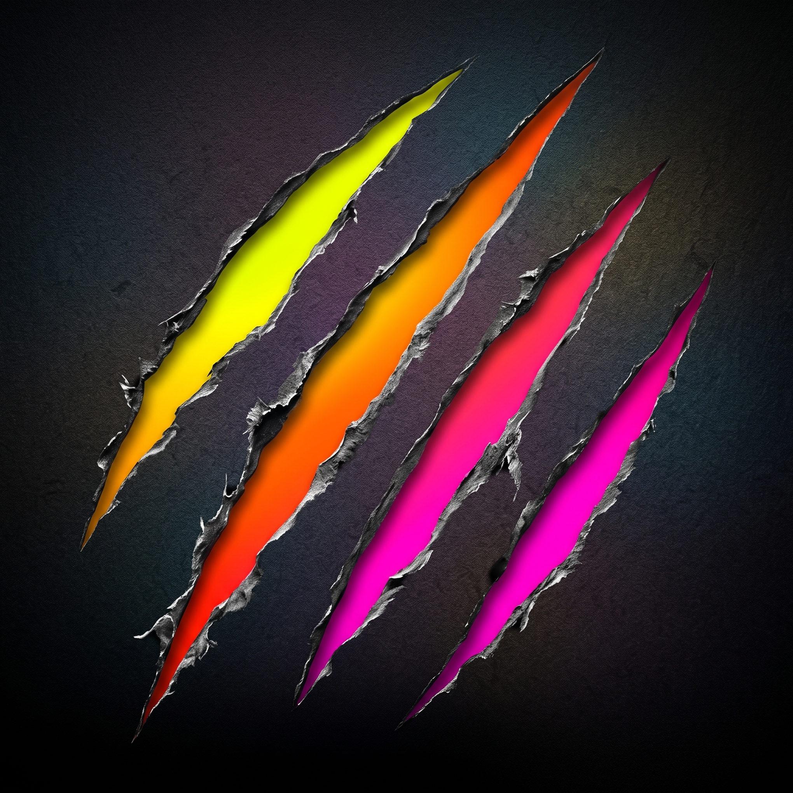

  

<h1 align="center">Razorcat</h1>

  <strong>A small, fast, precise video editor for Windows.</strong> 
  Trim, cut, crop and mark up a video, and export it, in less time than a big editor takes to
  start.

  <strong>In development</strong> · Windows 10 (1903+) and Windows 11 · x64

---

Razorcat is for the everyday edits: the screen recording that needs its first ten seconds cut,
the clip that needs an arrow and a label, the demo that needs a step marked up before it goes
into a bug report, a README or a course. It does those few things well, and fast.

1. **Open or record.** Drop a video on Razorcat, open it from Explorer, or record your screen
   (with your camera in a corner, and your clicks and keys) straight into the editor.
2. **Edit.** Split, trim and remove parts on a timeline where every edit lands on an exact
   frame. Crop the picture, or grow the frame with space for a caption.
3. **Mark up.** Arrows, boxes, text, callouts, redactions, spotlights and step markers, each
   shown for exactly as long as you choose, with fades.
4. **Export.** MP4 or GIF, using your graphics card's encoder when it has one.

> **Razorcat isn't released yet.** The first beta is on its way.

## Why Razorcat?

- **Precise.** Every cut, trim and markup item lands on a frame, never between two. Step a
  frame at a time, and the export matches the preview frame for frame.
- **Fast.** Opens in a moment, plays even long recordings smoothly, and exports quickly.
- **Nothing to learn.** One track, one timeline. Clips close up when you remove something, and
  trimming one moves the rest along without overwriting them.
- **Markup from [Vandal](https://github.com/flowcat-software/vandal).** The same tools, styles
  and keyboard shortcuts as Vandal, its sibling screenshot app, now timed on the video.
- **Your source files are never changed.** Razorcat saves your edits as a project (`.rct`) and
  renders a new file when you export. It autosaves as you work, so a crash doesn't lose
  anything.
- **Private.** No account, no telemetry, no uploads. Everything happens on your PC.
- **Free and open source.** GPL-3.0. See [License](#license) for how businesses are asked to
  support it.

## Features

**Recording**

- Record the screen, a window or a region, with a countdown
- Your camera in a bubble you can move and resize, recorded separately so you can change it
  later
- Your clicks and the shortcuts you press, shown on the video as markup you can edit

**Editing**

- One magnetic track: split, ripple trim, reorder and delete clips
- Mark time ranges to keep or remove, several at once
- Change a clip's speed
- Crop the picture, and grow the frame on any side in a colour of your choice, from presets
  (captions above or below, black bars) or exact sizes
- Undo everything, frame-accurate snapping, zoom from the whole video down to single frames
- Projects (`.rct`) that open in Razorcat, with autosave and recovery

**Markup**

- Pen, highlighter, line, arrow, rectangle, ellipse, text, callout, redact (solid, pixelate or
  blur), spotlight and step markers
- Each item has its own lane on the timeline: drag its ends to set when it shows, and give it
  a fade in and out
- Single-key tools and number-key styles, as in Vandal

**Export**

- MP4 (H.264 and AAC) or GIF (through [gifski](https://gif.ski))
- Hardware encoding on NVIDIA, AMD and Intel graphics, with a fallback that always works
- The whole timeline, a single clip, or each clip as its own file

## Install

Razorcat isn't released yet. When it is, its installer will be on the
[Releases](https://github.com/flowcat-software/razorcat/releases) page. It installs for your
user account only (no administrator rights), and updates itself when you say so, with every
update signed and checked before it installs.

## Privacy

Razorcat works entirely on your PC. It doesn't collect usage data, and it has no account to
sign into. Its only network connection will be the update check, which you can turn off. Your
videos, recordings and projects never leave your computer unless you share them.

## Feedback and bug reports

Found a bug or have an idea? [Open an issue on GitHub](https://github.com/flowcat-software/razorcat/issues/new),
or look through the [existing issues](https://github.com/flowcat-software/razorcat/issues)
first. For a bug, please include your Razorcat version (**Settings › About**), your Windows
version, and what you did, what you expected and what happened instead.

Security problems are the exception: please report those privately, as
[SECURITY.md](SECURITY.md) explains.

## Building from source

Razorcat is open source. To build it yourself or to contribute, see
[DEVELOPMENT.md](DEVELOPMENT.md).

## License

Copyright © 2026 [Flowcat Software](https://flowcat.studio).

Razorcat is free software: you can redistribute it and/or modify it under the terms of the
[GNU General Public License](LICENSE) as published by the Free Software Foundation, either
version 3 of the License, or (at your option) any later version.

Razorcat is distributed in the hope that it will be useful, but WITHOUT ANY WARRANTY, without
even the implied warranty of MERCHANTABILITY or FITNESS FOR A PARTICULAR PURPOSE. See the GNU
General Public License for more details.

### Using Razorcat at work

Razorcat is free to download and use. If you use it at or for a business, we ask that you buy
a commercial licence for the builds we publish. It's an inexpensive one-time purchase that
keeps Razorcat going.

- **Free:** personal use, students, K–12 schools, nonprofits and open-source projects.
- **A licence is asked for:** use at or for a business, including client work, monetized
  channels and paid courses, and by colleges and universities.

This is an honour system. Razorcat never checks for a licence, and nothing is locked without
one. It's a request attached to our official builds, not a restriction on the code: the GPL
still gives everyone the right to build Razorcat from source and use it as the GPL allows.
Prices and how to buy will be on Razorcat's website at launch.

Not using it for work? You can still support Razorcat with a donation (coming soon).

### Third-party software

Razorcat ships two separate programs beside it, each under its own licence (in the `licenses`
folder where Razorcat is installed):

- [FFmpeg](https://ffmpeg.org), under the GNU GPL v3.0 or later.
- [gifski](https://gif.ski), under the GNU AGPL v3.0 or later.
